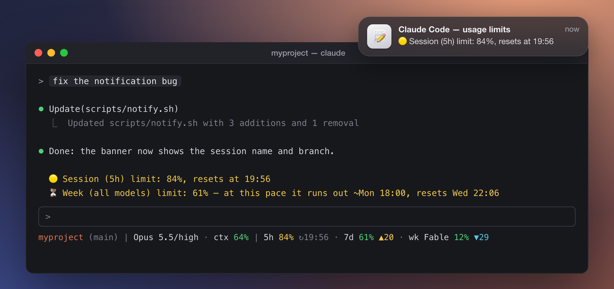
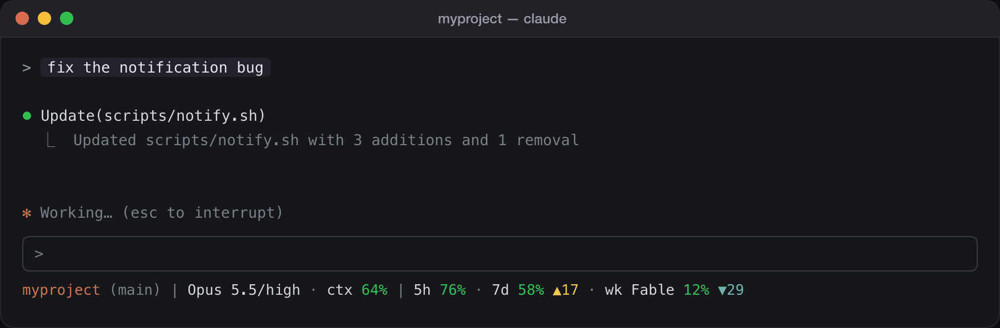

# claude-code-limit-alerts

[Русский](README.md) | **English**

[](https://github.com/aquahitt/claude-code-limit-alerts/releases)
[](#as-a-plugin-recommended)
[](#roadmap)
[](LICENSE)

**Know about a Claude Code limit before it stops your work.** The 5-hour and
weekly limits right in your statusline, a warning before a window runs out,
and a banner with sound when Claude is waiting for you.

<p align="center">
  
</p>

- **Exact numbers, not an estimate.** The same percentages `/usage` shows —
  from the same endpoint, not a token count over local logs. Work in other
  terminals, on other devices and on claude.ai counts too.
- **Ahead of time, not after the fact.** 🟡 at 80%, 🔴 at 95%, a ⏳ forecast
  ("at this pace it runs out ~Mon 18:00") and ♻️ when a window resets — even
  while Claude Code is closed.
- **No need to babysit the terminal.** When Claude waits for a permission or
  finishes a task, you get a banner with the session name and git branch.
- **Nothing extra.** Plain bash + `jq`, no API keys or logins: Claude Code's
  OAuth token is read from the Keychain and goes to `api.anthropic.com` only.

**Install in a minute** — two commands in Claude Code:

```
/plugin marketplace add aquahitt/claude-code-limit-alerts
/plugin install limit-alerts@claude-code-limit-alerts
```

Then `/plugin` → limit-alerts → Configure: set `lang` to `en` (notifications
default to Russian) and turn on `statusline` and `launchd` (off by default
because they write outside the plugin). More under
[Installation](#installation).

> 🍎 **macOS only for now.** Windows and Linux support is planned — see [Roadmap](#roadmap).

<p align="center">
  
</p>

## What you get

**macOS notifications and in-app messages in Claude Code** (with `--lang en`):

```
🟡 Session (5h) limit: 82%, resets at 18:00
🔴 Week (all models) limit: 96% — almost exhausted, resets at Sat 10:00
♻️ Session (5h) limit was reset (was 96%, now 3%)
⏳ Week (all models) limit: 46% — at this pace it runs out ~Thu 14:00, resets Sat 10:00
💳 Paid usage credits are being spent: $4.20
⌛ Week (all models) limit: 40%, resets Sat 10:00 — at this pace ~55% goes unused
```

**The forecast** ⏳ answers "will it last until the reset?" before the 80%
threshold fires: when the limit would run out before its window resets at the
current pace, you get one notification per window. The pace comes from the
history of readings: the last hour for the 5-hour window, the last day for the
week (nights and breaks included). The forecast stays silent while there is
little data, below 25% of the week, and when the margin to the reset is thin —
a false alarm is worse than none. **Paid credits** 💳: when the plan's limits
are used up and money starts being spent, and at 80%/95% of the spending limit.
**Unused limit** ⌛: a subscription is paid for even when it sits idle. In the
last day before the week resets, if at the current pace 20 points or more
would go unused, you get one reminder — while there is still time to use
them.

**Safeguards — off by default, on if you want them:**

- *Ask before a subagent.* Once a weekly limit reaches 95%, starting a
  subagent asks for confirmation first: subagents spend a week fastest, and a
  week that runs out stops work for days. The decision stays yours — it is a
  question, not a block. A model-scoped limit counts only when the subagent
  is explicitly given that model.
- *Suggest another model.* The 🔴 for a model-scoped weekly limit gets
  "↪ You can carry on with another model (/model): it does not spend this
  limit" — while the limit for all models still has room.

**Statusline with all limit percentages** (green / yellow ≥ 80% / red ≥ 95%):

```
[your statusline] | 5h 71% · 7d 46% ▲8 · wk Fable 4%
```

`▲8` (yellow) means the week is 8 points ahead of an even pace: 38% of the
week has elapsed, 46% is spent, and at this pace the limit runs out before the
reset. `▼18` (cyan) is the opposite, 18 points behind: part of the limit will
reset unused, and the subscription is paid for either way. The arrow shows
from 5 points off the pace, and not in the first 12 hours of the window.

**"Needs your attention" notifications** — when Claude waits for a permission
or a reply, or finishes a task, you get a banner with sound. The title carries
the session name (or project dir) and git branch, the subtitle carries your
last prompt — so you instantly know which terminal to switch to:

```
Claude: stroi-homes (develop)          ← which session
fix the notification bug…              ← what it works on
Needs permission or a reply            ← what happened   (sound: Funk)
Task finished                          ←                  (sound: Glass)
```

The sound is played directly via `afplay`, so it works even when banners are
not allowed in Notification Center.

**Manual check from the terminal:**

```
$ ~/.claude/scripts/usage-monitor.sh status
claude-code-limit-alerts vX.Y.Z
Session (5h)          71%  resets: 16.07 18:00  · runs out ~17:10
Week (all models)     46%  resets: 17.07 10:00  · on pace: 38%
Week (Fable)           4%  resets: 17.07 10:00  · on pace: 38%  · ~10% by reset (90% left unused)
Weekly usage by product: Claude Code 88%, Chats 12%
```

"On pace" is where the week would be if spent evenly. "Runs out" is the
forecast, when the limit would run out before the reset at the current pace.
"~10% by reset (90% left unused)" is the opposite case: at the current pace
about 10% will be spent by the reset and the rest is lost. The product line
gives shares of what the week has spent (Claude Code, chats, Cowork), not
shares of the limit; it appears once two or more products have usage. If paid
credits were spent, their amount follows.

If live data can't be fetched (for example, the endpoint answers 429),
`status` shows the last cache marked "⚠ No live data — showing the cache from
… (N min ago)", and flags windows that have rolled over since with
"(already reset)". In the plugin, the `limit-alerts:status` skill does the same.

## How it works

- The script polls the same endpoint the `/usage` command in Claude Code uses
  (`api.anthropic.com/api/oauth/usage`); the OAuth token is read from the macOS
  Keychain — no extra API keys or logins required.
- **Claude Code hooks** (`Stop` + `SessionStart`) surface warnings right in the
  UI after each turn and on session start.
- A **launchd agent** checks limits in the background (every 92 seconds by default) — the
  window-reset notification arrives even when Claude Code is closed.
- **Two ways to run it.** The plugin registers its own hooks and keeps state in
  its own data directory; `install.sh` copies the scripts into
  `~/.claude/scripts` and appends hooks to `~/.claude/settings.json`. The
  monitoring logic is identical in both — they are the same files.
- The **statusline wrapper** appends percentages to your existing statusline
  (which is preserved and keeps rendering). Each window shows the fresher of
  two numbers: the one Claude Code passes the statusline from this session's
  last API response, or the account-wide one the monitor fetched — so the line
  also reflects work in other terminals, on other devices, on claude.ai, even
  while this terminal just sits open. The statusline refreshes a stale cache
  itself, in the background, without delaying the redraw. Several open
  terminals — idle or working — show the same, freshest number and share a
  single request. Once a window
  reaches the warning threshold, its reset time appears next to it:
  `5h 84% ↻00:20`.
- No spam: one notification per threshold (80% and 95%) per window; a reset is
  only announced if usage was ≥ 50%.

Details in [docs/how-it-works.md](docs/how-it-works.md).

## The compact signal and the model in the statusline

**Continuing after a limit reset is Claude Code's own job.** `/config` has a
"Continue automatically at usage limit" toggle (`autoContinueAtUsageLimit` in
`~/.claude/settings.json`): the session waits out the reset and carries on by
itself — no exit, no second terminal, no `--resume`. Up to 0.4.0 this project
did the same thing from the outside via `auto-resume.sh`; 0.5.0 removes it,
because an external worker cannot do it better and, running alongside the
built-in one, would resume a single conversation twice. `install.sh` and
`update.sh` clean up the files left behind by earlier versions.

**The `/compact` signal.** A hook cannot run `/compact` — the hook output
schema has no compaction verb. So `compact-advisor.sh` sends a signal at the
moment compacting is cheapest: context is past the threshold (70% by default),
the turn ended with an answer rather than a tool call, and no tasks are left
unfinished.

For a fully automatic backstop, move Claude Code's own threshold:

```bash
./install.sh --auto-compact-window 140000   # 100000..1000000 tokens
```

**The model in the statusline.** The status line shows the session's model,
its `effort` level and how full the context is — and, when a subagent runs on
a different model, that model too:

```
myproject (main) | Opus 5/high · adv Fable · ctx 72% · ⇢ Haiku 4.5 | 5h 66% · 7d 7% · wk Fable 4%
```

All of that arrives on the statusline's stdin, so the segment costs no network
or disk access. The one exception is the subagent model, read from
`~/.claude/projects/<project>/<session_id>/subagents/`, where "running right
now" means "written within `UM_SUBAGENT_TTL` seconds" (180 by default). A
subagent that stays silent longer than that — one long tool call — drops off
the line until it writes again. Subagents on the session's own model are never
shown; several on one model collapse into `⇢ 2× Haiku 4.5`.

`adv Fable` is Claude Code's own advisor model (the `/advisor` command, stored
as `advisorModel` in `settings.json`). It appears only when its family differs
from the session's, so `advisorModel: opus` under an Opus session adds nothing.
Advisor calls are separate requests with their own context — they do not fill
the session window and do not affect `ctx`.

`wk Fable 4%` is the weekly **model-scoped limit**, not a running model — the
prefix exists precisely because a real model name now shares the line. Do not
confuse it with `adv Fable`: the first is how much of that model's weekly quota
is left, the second is what you are consulting.

Turn any of it off: `./install.sh --no-compact-advisor`, `./install.sh --no-statusline-model`,
`./install.sh --no-subagent-model`.

## Installation

Requirements: macOS, [jq](https://jqlang.github.io/jq/) (`brew install jq`),
Claude Code signed in with a claude.ai subscription — Pro, Max, Team or
Enterprise (not an API key, see the [FAQ](#faq)).

Two ways. The plugin is the primary one; `install.sh` stays for anyone who
needs `--auto-compact-window` or an install without a marketplace.

### As a plugin (recommended)

```
/plugin marketplace add aquahitt/claude-code-limit-alerts
/plugin install limit-alerts@claude-code-limit-alerts
```

Claude Code registers the hooks itself — `~/.claude/settings.json` is not
touched. All state lives in the plugin's data directory and survives updates.

Configure it under `/plugin` → limit-alerts → Configure:

| Option | Default | Effect |
|---|---|---|
| `lang` | `ru` | notification language (`ru` / `en`) |
| `warn` | `80` | 🟡 threshold, percent |
| `crit` | `95` | 🔴 threshold, percent |
| `compact_warn` | `70` | `/compact` signal threshold, % of context |
| `attention` | on | "needs your attention" notifications |
| `compact_advisor` | on | the `/compact` signal |
| `forecast` | on | ⏳ forecast: a limit runs out before it resets |
| `spend_alert` | on | 💳 notifications about paid usage credits |
| `unused_alert` | on | ⌛ reminder: a weekly limit would reset unused |
| `statusline_pace` | on | `▲N` / `▼N` — weekly pace in the statusline |
| `guard_fanout` | off | ask before a subagent once the week is at 95% |
| `model_hint` | off | suggest another model at a model-scoped limit |
| `statusline` | **off** | limit percentages in the statusline |
| `statusline_model` | on | model segment in the statusline |
| `subagent_model` | on | subagent model in the statusline |
| `launchd` | **off** | background agent |
| `interval` | `92` | agent check interval, seconds (60–3600) |

The last two are off on purpose: they write outside the plugin — into
`~/.claude/settings.json` and `~/Library/LaunchAgents`. Turn them on in the
configuration dialog and the change applies at the next session start, or
immediately via `/limit-alerts:setup`. An existing statusline is not
overwritten: it is preserved, keeps rendering, and the percentages are
appended after it.

Plugin skills:

| Skill | Effect |
|---|---|
| `/limit-alerts:status` | show current limits |
| `/limit-alerts:doctor` | check the installation when something does not work |
| `/limit-alerts:setup` | apply the statusline and agent settings now |
| `/limit-alerts:uninstall` | remove the statusline and the agent before removing the plugin |

> ⚠️ Do not run the plugin and `install.sh` side by side: hooks fire twice and
> notifications get duplicated. The plugin detects this and warns once. It also
> leaves the statusline and the agent completely alone in that case.

### With `install.sh`

```bash
git clone https://github.com/aquahitt/claude-code-limit-alerts.git
cd claude-code-limit-alerts
./install.sh --lang en
```

Installer flags:

| Flag | Effect |
|---|---|
| `--no-statusline` | leave the statusline untouched |
| `--no-launchd` | skip the background agent (hooks only) |
| `--no-attention` | skip "needs your attention" notifications |
| `--lang en` | English notifications (default is Russian) |
| `--warn N` / `--crit N` | 🟡 and 🔴 thresholds, % (80 and 95 by default) |
| `--interval N` | background agent check interval, seconds, 60–3600 (92 by default) |
| `--proxy <url>` | proxy for the background agent; by default taken from `HTTP_PROXY`/`HTTPS_PROXY`/`ALL_PROXY`/`NO_PROXY` in the current shell, `--proxy ""` turns it off |
| `--compact-warn N` | `/compact` signal threshold, % of context (70 by default) |
| `--no-compact-advisor` | skip the `/compact` signal |
| `--auto-compact-window <tokens>` | move Claude Code's own auto-compact threshold (100000–1000000); affects every session |
| `--no-statusline-model` | statusline shows limits only — no model / effort / context / subagent segment |
| `--no-subagent-model` | statusline keeps the session model but drops the subagent model |
| `--no-forecast` | no ⏳ forecast |
| `--no-spend-alert` | no 💳 notifications about paid credits |
| `--no-unused-alert` | no ⌛ reminder about an unused limit |
| `--no-statusline-pace` | no `▲N` / `▼N` in the statusline |
| `--guard-fanout` | ask before a subagent once the week is at 95% |
| `--model-hint` | suggest another model at a model-scoped limit |

Restart Claude Code afterwards (or open `/hooks` once) so the new hooks are
picked up. A backup of `~/.claude/settings.json` is created before any change.

## Update

### Plugin

Claude Code updates only the official marketplaces by itself; this one is a
third-party marketplace, so pull a new version yourself, either way:

- from a terminal — the command refreshes the marketplace catalogue and
  installs the latest version:
  ```bash
  claude plugin update limit-alerts@claude-code-limit-alerts
  ```
- in Claude Code — `/plugin` → Marketplaces → `claude-code-limit-alerts`:
  update the catalogue, then the plugin. Auto-update can be turned on there
  too — Claude Code then checks for a new version on every start.

**Restart Claude Code after the update.** Until then:

- open sessions keep the hooks of the version they started with. From 0.11.3
  on, such a session leaves the checks to the installed version — no
  duplicates, no outdated notifications; sessions on earlier versions keep
  checking on their own;
- the statusline and the background agent run from a copy of the scripts in
  the plugin's data directory, which is refreshed on the first session start
  on the new version.

Which version runs: the first line of `/limit-alerts:status`.
`/limit-alerts:doctor` warns when a session is still on an older one.

### Classic install

```bash
git pull
./update.sh
```

Compares the installed version (`~/.claude/scripts/.limit-alerts-version`)
against `VERSION` in the repo, re-copies changed scripts, reloads the
launchd agent if its config changed, and re-checks hook registration —
without installing anything you opted out of (`--no-statusline`/
`--no-launchd`/`--no-attention` are still respected). `--dry-run` shows what
would change without changing anything; `--proxy` works as in `install.sh`.
See [CHANGELOG.md](CHANGELOG.md)
for what changed between versions.

## Configuration

Every feature can be configured in either installation, and the setting
applies everywhere the feature runs — hooks, the statusline and the background
agent:

- **plugin** — `/plugin` → limit-alerts → Configure;
- **`install.sh`** — a flag at install time; `update.sh` remembers it;
- **variable** — in the environment or in `env` of `~/.claude/settings.json`.
  Hooks and the statusline see it, the background agent does not: launchd
  starts it without your environment. For the agent, use the plugin option or
  the flag.

| What | Plugin | `install.sh` | Variable | Default |
|---|---|---|---|---|
| message language | `lang` | `--lang en` | `UM_LANG` | `ru` |
| 🟡 threshold, % | `warn` | `--warn N` | `UM_WARN` | `80` |
| 🔴 threshold, % | `crit` | `--crit N` | `UM_CRIT` | `95` |
| "needs your attention" | `attention` | `--no-attention` | — | on |
| `/compact` signal | `compact_advisor` | `--no-compact-advisor` | — | on |
| its threshold, % of context (and yellow `ctx`) | `compact_warn` | `--compact-warn N` | `UM_COMPACT_WARN` | `70` |
| ⏳ forecast | `forecast` | `--no-forecast` | `UM_FORECAST=0` | on |
| 💳 paid credits | `spend_alert` | `--no-spend-alert` | `UM_SPEND_ALERT=0` | on |
| ⌛ unused limit | `unused_alert` | `--no-unused-alert` | `UM_UNUSED_ALERT=0` | on |
| ask before a subagent | `guard_fanout` | `--guard-fanout` | `UM_GUARD_FANOUT=1` | off |
| suggest another model | `model_hint` | `--model-hint` | `UM_MODEL_HINT=1` | off |
| statusline | `statusline` | `--no-statusline` | — | plugin: off, `install.sh`: on |
| model segment in the statusline | `statusline_model` | `--no-statusline-model` | `UM_STATUSLINE_MODEL=0` | on |
| subagent model in the statusline | `subagent_model` | `--no-subagent-model` | `UM_SUBAGENT_MODEL=0` | on |
| `▲N` / `▼N` — weekly pace | `statusline_pace` | `--no-statusline-pace` | `UM_STATUSLINE_PACE=0` | on |
| background agent | `launchd` | `--no-launchd` | — | plugin: off, `install.sh`: on |
| agent interval, s (60–3600) | `interval` | `--interval N` | — | `92` |

If the endpoint answers 401, 403 or 429, the agent pauses on its own (5
minutes and up) whatever the interval. An interval below 92 seconds means more
requests to the endpoint and a higher chance of a 429.

Fine-tuning is by variable only: it is rarely needed, and more entries in the
plugin menu and more flags would make the useful ones harder to find.

| Variable | Default | Meaning |
|---|---|---|
| `UM_RESET_MIN` | `50` | minimum usage for a window reset to be announced |
| `UM_CACHE_TTL` | `60` | API response cache lifetime, seconds |
| `UM_CONTEXT_WINDOW` | `200000` | context window used for the percentage (overridden by `autoCompactWindow` in `settings.json`) |
| `UM_STATUSLINE_CTX` | `1` | show `ctx N%` inside the model segment |
| `UM_STATUSLINE_ADVISOR` | `1` | show the advisor model (`/advisor`) |
| `UM_STATUSLINE_RESET` | `1` | reset time next to a window that reached the warning threshold: `5h 84% ↻00:20`, the date `↻15.10` when it is over a day away |
| `UM_SUBAGENT_TTL` | `180` | how recently a subagent must have written for it to count as running, seconds |
| `UM_STATUSLINE_BG_REFRESH` | `1` | the statusline refreshes a stale cache in the background (what keeps usage from other devices visible without the background agent) |
| `UM_STATUSLINE_REFRESH_AFTER` | `120` | cache age, seconds, after which the statusline starts a refresh |

## Troubleshooting

Start with `doctor`. It checks the installation from files, without asking
the endpoint (safe even during a 429 pause): the Keychain token, the account,
the age of the data, the pause, the last error, the history, the background
agent, the statusline, the hooks, a double installation and a stale plugin
session.

```
$ ~/.claude/scripts/usage-monitor.sh doctor
claude-code-limit-alerts vX.Y.Z
· Installation: install.sh, state in /Users/you/.claude/scripts
✓ jq: /opt/homebrew/bin/jq
✓ Keychain token: present, plan max
✓ Account: 1a2b3c4d-5e6f7a8b
✓ Last data: 1 min ago
✓ History: 1240 readings over 6 d
✓ Background agent: on, every 92 s
✓ Statusline: on
· Banners can't be checked from here: 'doctor --notify' sends a test one.
```

`doctor --notify` sends a test notification. In the plugin, the
`limit-alerts:doctor` skill does the same.

Every notification sent and every failed attempt to fetch data (an expired
token, a 403 for team/org accounts, a stale local cache, etc.) is logged
with a reason:

```bash
cat ~/.claude/scripts/usage-monitor.log       # full log
grep "fetch failed" ~/.claude/scripts/usage-monitor.log | tail -30   # fetch failures only
tail -f ~/.claude/scripts/usage-monitor.log   # watch live
```

Seeing a run of `fetch failed: ...` lines isn't necessarily a bug — the live
endpoint may be unreachable (see FAQ below), and the local-cache fallback
waits for a fresh (under an hour old) `cachedUsageUtilization` in
`~/.claude.json` before it will use it.

Check the launchd agent's state:

```bash
launchctl list | grep com.claude.usage-monitor
```

## Uninstall

The plugin: run `/limit-alerts:uninstall` first, then remove the plugin with
`/plugin`. The order matters — disabling a plugin does not by itself remove the
statusline or unload the launchd agent, because those are writes outside the
plugin.

The classic install:

```bash
./uninstall.sh
```

Unloads the launchd agent, removes the hooks from settings, restores your
previous statusline, and deletes the scripts.

## Experimental: a mod with a `/limits` command

`mods/limit-alerts-status/` holds a separate plugin of Claude Code TypeScript
hooks (a mod). It adds a `/limits` command that prints a summary at once —
**no model turn, no tokens**, unlike the `limit-alerts:status` skill, which
answers through the model. It also works mid-turn.

```
Claude Code limits
⚠ Session (5h): 87% — resets 15:19 (in 2 h 50 min)
⚠ Week (all models): 90% — resets 15.10 19:59 (in 5 d 7 h) · on pace: 24%
Week (Fable): 4%
Source: this session's last API response. The model-scoped weekly limit comes from the monitor's cache (5 min ago).
```

Each window takes the fresher number — from this session's last API response
or from `usage-monitor-cache.json` (from `UM_STATE_DIR`, `~/.claude/scripts`,
or the `limit-alerts` plugin's data directory), as in the statusline; the
summary says where each window came from. The model-scoped weekly limit always
comes from the cache. Weekly windows get "on pace", as in `status`; the
weekly split by product and paid credits also come from the cache. If the
monitor is backing off after an HTTP 429, the summary says so.

To run it:

```bash
claude --plugin-dir mods/limit-alerts-status
```

Its options (`lang`, `warn`, `crit`, `state_dir`) show up in the config menu.
The mod is not part of the `limit-alerts` plugin or the marketplace: the mod
API is still early access and may change between Claude Code versions.

## FAQ

**I switch between several accounts — will the numbers get mixed up?**
No. Everything is tied to the current sign-in (account + organization from
`~/.claude.json`): each account has its own notification state and its own
pause after errors, and the cache and the statusline show only the current
account's numbers. Switching causes no false "♻️ reset" and no repeated
warnings.

**Does it work with Team and Enterprise, not just a personal plan?**
Yes — the data sources are the same for any claude.ai sign-in. The statusline
takes 5h/7d from what Claude Code itself passes it from API responses, which
does not depend on the plan. The monitor asks the same endpoint as `/usage` in
Claude Code; if it answers 403 for your account (seen with Team/organization
accounts), the monitor refreshes once through Claude Code itself
(`claude -p /usage`) and pauses, instead of asking again every 92 seconds.
Windows your plan doesn't have are simply not shown — no fake `0%`.

**Notifications don't show up.**
Make sure notifications from "Script Editor" are allowed in
macOS Settings → Notifications. The script sends them via `osascript`.

**Is this an official Anthropic tool?**
No. It relies on an undocumented endpoint that Claude Code itself uses for the
`/usage` command — the response format may change. If it does, the scripts
silently stop showing data (nothing breaks).

**Will the token expire?**
Claude Code refreshes the OAuth token itself; the script always reads the
current one from the Keychain. If the token is invalid, the check is silently
skipped until the next cycle.

## Roadmap

- [ ] **Linux** — credentials from `~/.claude/.credentials.json`, notifications via `notify-send`, `systemd` timer instead of launchd
- [ ] **Windows** — Credential Manager, toast notifications, Task Scheduler
- [ ] Optional Telegram notifications

## License

[MIT](LICENSE)
